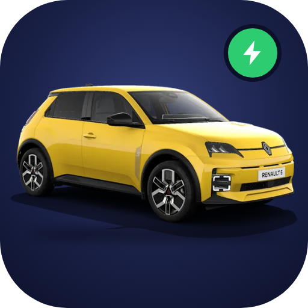
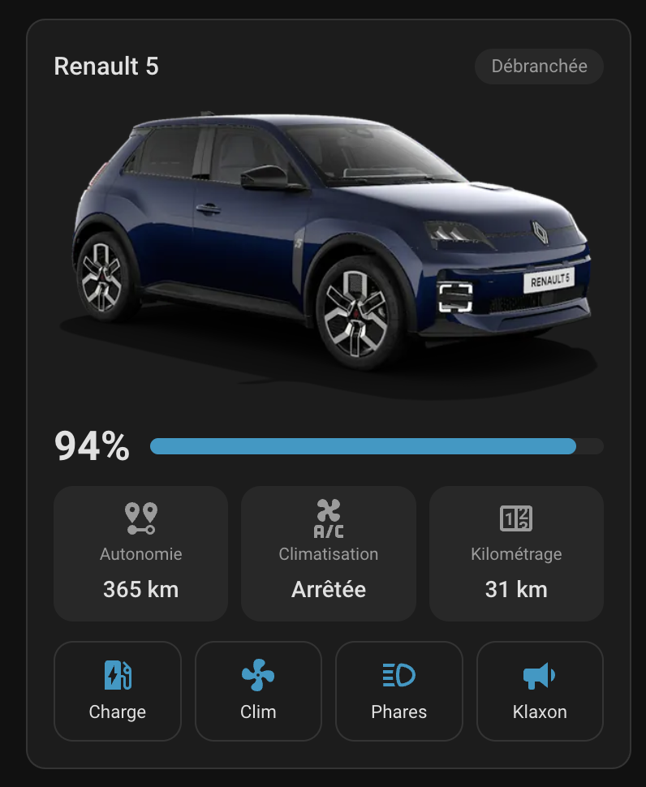
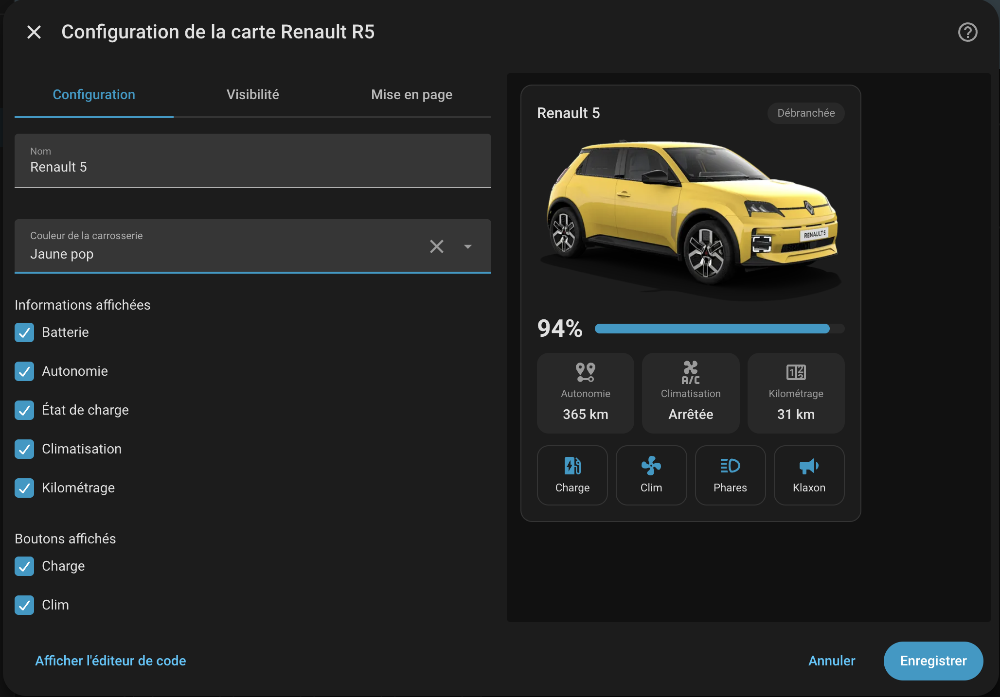

#  Renault R5 Card

[](https://hacs.xyz)

A Home Assistant Lovelace card for the electric Renault 5: a picture of the car
in your body colour, battery level, range, charge state, climate, mileage and
quick actions (start charge, air conditioning, flash lights, horn). Tap a value
to open its entity; each button shows whether its press went through.

<p align="center">
  
</p>

It reads the entities created by the core
[Renault integration](https://www.home-assistant.io/integrations/renault/), so set that up first.

## Installation

### HACS (recommended)

1. HACS → ⋮ → **Custom repositories**
2. Add `https://github.com/Pouzor/renault-r5-lovelace`, type **Dashboard**
3. Install **Renault R5 Card**, then reload the browser

HACS registers the dashboard resource by itself. If your resources are managed
in YAML (`lovelace: resource_mode: yaml`), it cannot: add the resource yourself
and restart Home Assistant.

```yaml
lovelace:
  resources:
    - url: /hacsfiles/renault-r5-lovelace/renault-r5-card.js
      type: module
```

### Manual

Download `renault-r5-card.js` from the
[latest release](https://github.com/Pouzor/renault-r5-lovelace/releases), copy it
to `config/www/`, and add it under Settings → Dashboards → Resources:

```yaml
url: /local/renault-r5-card.js
type: module
```

This `/local/` URL only applies to a manual copy; a HACS install is served from
`/hacsfiles/renault-r5-lovelace/`.

## Configuration

The card ships a visual editor:



YAML equivalent:

```yaml
type: custom:renault-r5-card
name: Renault 5
color: pop_yellow_black_roof
show_info: [battery, range, status, hvac, mileage, updated]
show_buttons: [start_charge, start_ac, flash_lights, horn]
buttons_position: bottom
low_battery_threshold: 20
battery_entity: sensor.r5_battery
range_entity: sensor.r5_battery_autonomy
mileage_entity: sensor.r5_mileage
charging_entity: binary_sensor.r5_charging
plugged_entity: binary_sensor.r5_plugged_in
charging_remaining_time_entity: sensor.r5_charging_remaining_time
hvac_entity: binary_sensor.r5_hvac
last_update_entity: sensor.r5_battery_last_activity
start_charge_entity: button.r5_start_charge
start_ac_entity: button.r5_start_air_conditioner
flash_lights_entity: button.r5_flash_lights
horn_entity: button.r5_sound_horn
```

Entity ids depend on the vehicle name and on the language Home Assistant was in
when the integration was set up (`sensor.<car>_batterie` in French, for
instance). When you add the card from the dashboard picker, it fills in the
entities of your Renault vehicle by itself.

Every option is optional. An info item or a button is displayed when it is
listed in `show_info` / `show_buttons` **and** its entity is set (`updated`
needs no entity of its own).

| Option | Description |
|---|---|
| `name` | Card title, defaults to "Renault 5" |
| `color` | Body colour of the picture, see below. Defaults to `pop_yellow` |
| `show_info` | Info items to display, any of `battery`, `range`, `status`, `hvac`, `mileage`, `updated`. Defaults to all |
| `show_buttons` | Buttons to display, in order, any of `start_charge`, `start_ac`, `flash_lights`, `horn`. Defaults to all |
| `show_charge` | Charging cost figures to display, in order, any of `last_cost`, `last_energy`, `last_distance`, `cost_per_100km`, `consumption`, `total_cost`. Defaults to all — see [Charging costs](#charging-costs) |
| `charge_layout` | How the charging costs are laid out: `compact` (default), one panel with the last charge, the total and the per-100 km figures, or `tiles`, one tile per figure in the `show_charge` order |
| `buttons_position` | Where the buttons go: `bottom` (default), in a row below the card, `right`, in a column beside the car for wide cards, or `compact`, small round icon buttons tucked right under the car |
| `low_battery_threshold` | Battery level (%) at or below which the bar turns red. Defaults to `20` |
| `battery_entity` | Battery level sensor (%) — `battery` |
| `range_entity` | Remaining range sensor — `range` |
| `mileage_entity` | Mileage sensor — `mileage` |
| `charging_entity` | Binary sensor, `on` while charging — `status` |
| `plugged_entity` | Binary sensor, `on` while plugged in — `status` |
| `charging_remaining_time_entity` | Remaining charge time sensor, shown next to "Charging" while the car charges — `status` |
| `hvac_entity` | Binary sensor, `on` while the air conditioning runs — `hvac` |
| `last_update_entity` | Timestamp sensor of the last data sent by the car, shown as "Updated 5 minutes ago" under the title — `updated`. The integration's "Battery last activity" sensor fits, but is disabled by default. Without it, the card uses the latest update among the entities above |
| `start_charge_entity` | Button entity pressed by "Charge" |
| `start_ac_entity` | Button entity pressed by "Climate" |
| `flash_lights_entity` | Button entity pressed by "Lights" |
| `horn_entity` | Button entity pressed by "Horn" |

### Colours

| `color` | Paint |
|---|---|
| `pop_yellow` / `pop_yellow_black_roof` | Pop yellow |
| `pop_green` / `pop_green_black_roof` | Pop green |
| `pearl_white` / `pearl_white_black_roof` | Pearl white |
| `midnight_blue` / `midnight_blue_black_roof` | Midnight blue |
| `slate_grey` / `slate_grey_black_roof` | Slate grey |
| `starry_black` | Starry black |

### Charging costs

With the [EV Charge Cost](https://github.com/Pouzor/ev-charge-cost) integration,
the card adds a compact "Charging costs" panel below the car (or one tile per
figure with `charge_layout: tiles`), and the cost of the
charge in progress next to "Charging". The sensors are picked up automatically
when the card is added; with an odometer configured in EV Charge Cost you also
get the distance, consumption and cost per 100 km.

```yaml
show_charge: [last_cost, last_distance, cost_per_100km]
charge_session_cost_entity: sensor.recharge_ve_session_cost
charge_last_cost_entity: sensor.recharge_ve_last_session_cost
charge_last_energy_entity: sensor.recharge_ve_last_session_energy
charge_last_distance_entity: sensor.recharge_ve_last_session_distance
charge_last_cost_per_100km_entity: sensor.recharge_ve_last_session_cost_per_100km
charge_last_consumption_entity: sensor.recharge_ve_last_session_consumption
charge_total_cost_entity: sensor.recharge_ve_total_cost
```

| Option | EV Charge Cost sensor — item |
| --- | --- |
| `charge_session_cost_entity` | Session cost, shown as a chip while charging |
| `charge_last_cost_entity` | Last session cost — `last_cost` |
| `charge_last_energy_entity` | Last session energy — `last_energy` |
| `charge_last_distance_entity` | Last session distance (km driven since the previous charge) — `last_distance` |
| `charge_last_cost_per_100km_entity` | Last session cost per 100 km — `cost_per_100km` |
| `charge_last_consumption_entity` | Last session consumption (kWh/100 km) — `consumption` |
| `charge_total_cost_entity` | Total cost — `total_cost` |

The card is displayed in English or French, following the Home Assistant
language.

## Development

```bash
npm install
npm run dev          # rebuild dist/renault-r5-card.js on save
npm run lint && npm run typecheck && npm test
```

A throwaway Home Assistant with HACS pre-installed and fake `sensor.r5_*`
entities:

```bash
./scripts/dev-ha.sh          # build + start, http://localhost:8124
./scripts/dev-ha.sh stop
```

On first start, go through HA onboarding, then add the card to a dashboard.
The fake entities are driven by the `input_number.r5_*` / `input_boolean.r5_*`
helpers (`dev/packages/renault_r5.yaml`).

## License

[MIT](LICENSE) for the code.

The car pictures in `src/assets/cars/` come from Renault's online configurator.
They remain the property of Renault and are **not** covered by the MIT license.
"Renault" and "Renault 5" are trademarks of Renault. This project is an
independent, community-made card: it is not affiliated with, endorsed by or
sponsored by Renault. The pictures will be removed on request from the rights
holder.
