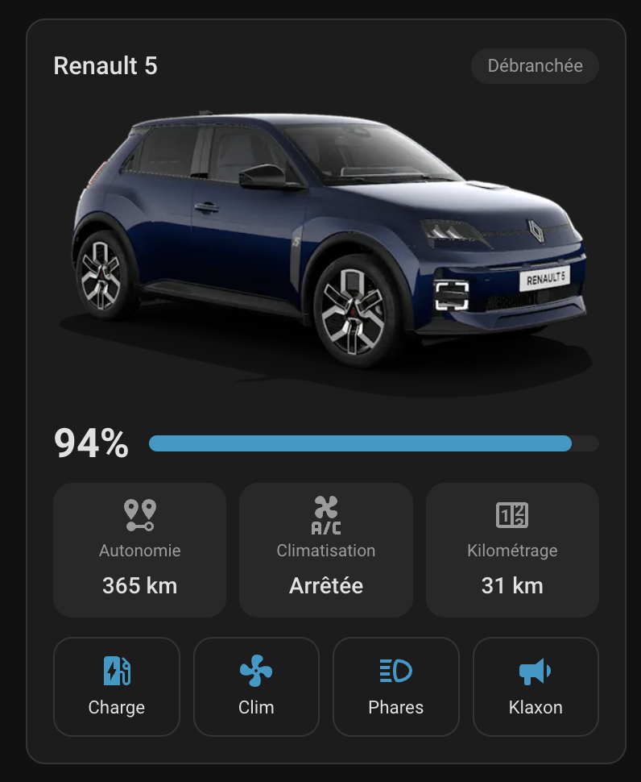
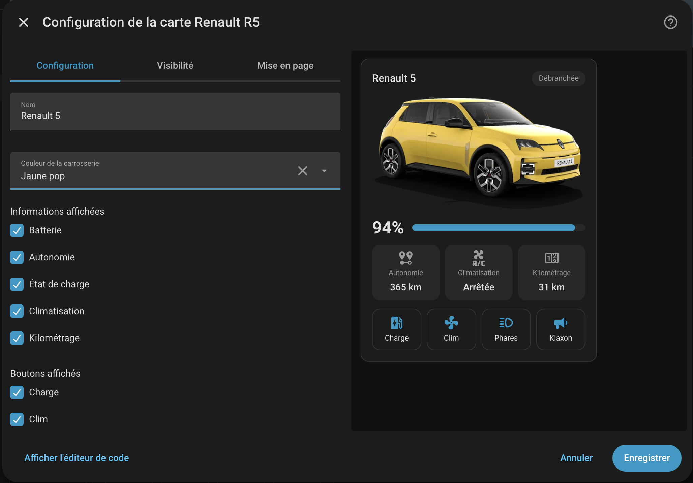

# Renault R5 Card

[](https://hacs.xyz)

A Home Assistant Lovelace card for the electric Renault 5: a picture of the car
in your body colour, battery level, range, charge state, climate, mileage and
quick actions (start charge, air conditioning, flash lights, horn).

<p align="center">
  
</p>

It reads the entities created by the core
[Renault integration](https://www.home-assistant.io/integrations/renault/), so set that up first.

## Installation

### HACS (recommended)

1. HACS → ⋮ → **Custom repositories**
2. Add `https://github.com/Pouzor/renault-r5-lovelace`, type **Dashboard**
3. Install **Renault R5 Card**, then reload the browser

### Manual

Download `renault-r5-card.js` from the
[latest release](https://github.com/Pouzor/renault-r5-lovelace/releases), copy it
to `config/www/`, and add it under Settings → Dashboards → Resources:

```yaml
url: /local/renault-r5-card.js
type: module
```

## Configuration

The card ships a visual editor:



YAML equivalent:

```yaml
type: custom:renault-r5-card
name: Renault 5
color: pop_yellow_black_roof
show_info: [battery, range, status, hvac, mileage]
show_buttons: [start_charge, start_ac, flash_lights, horn]
battery_entity: sensor.r5_battery
range_entity: sensor.r5_battery_autonomy
mileage_entity: sensor.r5_mileage
charging_entity: binary_sensor.r5_charging
plugged_entity: binary_sensor.r5_plugged_in
hvac_entity: binary_sensor.r5_hvac
start_charge_entity: button.r5_start_charge
start_ac_entity: button.r5_start_air_conditioner
flash_lights_entity: button.r5_flash_lights
horn_entity: button.r5_sound_horn
```

Entity ids depend on the vehicle name and on the language Home Assistant was in
when the integration was set up (`sensor.<car>_batterie` in French, for
instance). When you add the card from the dashboard picker, it fills in the
entities of your Renault vehicle by itself.

Every option is optional. An info item or a button is displayed when it is
listed in `show_info` / `show_buttons` **and** its entity is set.

| Option | Description |
|---|---|
| `name` | Card title, defaults to "Renault 5" |
| `color` | Body colour of the picture, see below. Defaults to `pop_yellow` |
| `show_info` | Info items to display, any of `battery`, `range`, `status`, `hvac`, `mileage`. Defaults to all |
| `show_buttons` | Buttons to display, in order, any of `start_charge`, `start_ac`, `flash_lights`, `horn`. Defaults to all |
| `battery_entity` | Battery level sensor (%) — `battery` |
| `range_entity` | Remaining range sensor — `range` |
| `mileage_entity` | Mileage sensor — `mileage` |
| `charging_entity` | Binary sensor, `on` while charging — `status` |
| `plugged_entity` | Binary sensor, `on` while plugged in — `status` |
| `hvac_entity` | Binary sensor, `on` while the air conditioning runs — `hvac` |
| `start_charge_entity` | Button entity pressed by "Charge" |
| `start_ac_entity` | Button entity pressed by "Climate" |
| `flash_lights_entity` | Button entity pressed by "Lights" |
| `horn_entity` | Button entity pressed by "Horn" |

### Colours

| `color` | Paint |
|---|---|
| `pop_yellow` / `pop_yellow_black_roof` | Pop yellow |
| `pop_green` / `pop_green_black_roof` | Pop green |
| `pearl_white` / `pearl_white_black_roof` | Pearl white |
| `midnight_blue` / `midnight_blue_black_roof` | Midnight blue |
| `slate_grey` / `slate_grey_black_roof` | Slate grey |
| `starry_black` | Starry black |

The card is displayed in English or French, following the Home Assistant
language.

## Development

```bash
npm install
npm run dev          # rebuild dist/renault-r5-card.js on save
npm run lint && npm run typecheck && npm test
```

A throwaway Home Assistant with HACS pre-installed and fake `sensor.r5_*`
entities:

```bash
./scripts/dev-ha.sh          # build + start, http://localhost:8124
./scripts/dev-ha.sh stop
```

On first start, go through HA onboarding, then add the card to a dashboard.
The fake entities are driven by the `input_number.r5_*` / `input_boolean.r5_*`
helpers (`dev/packages/renault_r5.yaml`).

## License

[MIT](LICENSE) for the code.

The car pictures in `src/assets/cars/` come from Renault's online configurator.
They remain the property of Renault and are **not** covered by the MIT license.
"Renault" and "Renault 5" are trademarks of Renault. This project is an
independent, community-made card: it is not affiliated with, endorsed by or
sponsored by Renault. The pictures will be removed on request from the rights
holder.
